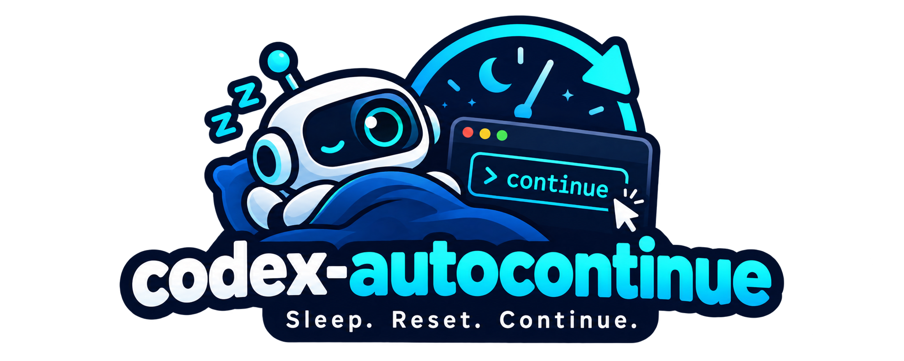

# ⏰ codex-autocontinue



**Hit your Codex usage limit at 11 PM? Go to sleep. It types `continue` for you when the limit resets.**

A tiny Python script that watches your Codex (GPT) window, reads the *"try again at Oct 17, 2026, 3:12 AM"* message with OCR, waits for that exact moment, then clicks the input, types `continue` and hits the blue send button. No API keys, no hacks, just a bot doing what you'd do with your own hands.

> ⭐ If this saved you a wasted night of waiting, **give it a star**. It's the cheapest way to say thanks and helps others find it.
> 🍴 Got a better idea (Wayland? macOS? Windows?) — **fork it and send a PR**.
> ❤️ Want to fuel more of these little tools? Hit the **Sponsor** button.

---

## 😴 TL;DR

**Can't be bothered to wait until your limit resets?** Me neither. Start the script and go to sleep. The moment the reset time hits, it types `continue` and presses Send. You wake up to finished work.

```bash
source .venv/bin/activate && python3 auto_continue.py -v
```

> 👉 Just make sure Codex is **visible on screen** and set to **Full access** (see [Before you walk away](#-before-you-walk-away)).

---

## ✨ What it does

| | |
|---|---|
| 👀 **Finds Codex by process/window class** | no screen guessing; works with multiple monitors |
| 🔎 **Reads the reset time with OCR** | parses *"try again at …"* / *"resets on …"* |
| ⏳ **Waits until the exact timestamp** | plus a small safety buffer |
| ⌨️ **Types `continue` + clicks Send** | waits for the voice button to switch to the send button |
| 🪄 **Gives you your desktop back** | restores your previous window and mouse position |
| 🧪 **Has a `--test` mode** | sends "Test" every 30s so you can verify it works |
| 🗣️ **Human-readable logs** | `-v` explains every step it takes |

## 🚀 Quick start (Ubuntu / X11)

✅ **Tested on Ubuntu 24.04.4 LTS** (Xorg session).

> Ubuntu 24.04 logs you into **Wayland** by default, which blocks screenshots and fake clicks. At the login screen click the ⚙️ gear and choose **"Ubuntu on Xorg"**.

```bash
git clone https://github.com/YOUR_GITHUB_USERNAME/codex-autocontinue.git
cd codex-autocontinue

# system tools
sudo apt install tesseract-ocr wmctrl xdotool python3-xlib python3-venv

# always use a virtual environment, then install deps INSIDE it
python3 -m venv .venv
source .venv/bin/activate
pip install -r requirements.txt

python3 auto_continue.py --list          # find your Codex window + monitors
python3 auto_continue.py --test -v       # sanity check: types "Test" and sends it
python3 auto_continue.py -v              # the real thing: leave it running
```

Every new terminal: `source .venv/bin/activate` before running the script.

## 🛌 Before you walk away

Run through this checklist, or the bot will click into the void:

- 👁️ **Codex must be visible** on screen: not minimized, not covered by another window, on the current workspace. The script reads pixels and clicks coordinates, so if it can't see Codex, it can't do anything.
- 📝 **Give Codex clear instructions** before the limit hits, so a plain `continue` actually means something ("finish the refactor, run the tests, fix what breaks").
- 🔓 **Set Codex permissions to Full access** (or at least an approval mode you're happy with). Otherwise it will resume, hit the next *"approve this command?"* prompt, and sit there waiting for you all night. Full access is powerful, so only use it in projects you trust.
- 🔆 **Keep the screen awake and unlocked** (disable auto-lock / blank screen while it waits).
- 🧪 Run `--test -v` once first to confirm typing and the Send click work on your setup.

## 🎛️ Options

| Flag | What it does |
|---|---|
| `--list` | Lists all windows (id, pid, process, class, title) and monitors |
| `--dry` | Finds the window, input box and button, but clicks nothing |
| `--test` | Every 30s: types `Test`, waits 2s, clicks Send |
| `--match REGEX` | Override how the Codex window is matched (default `codex`) |
| `--monitor N` | Skip detection, treat monitor N as the Codex screen |
| `--region x,y,w,h` | Skip detection, use an exact screen area |
| `-v`, `--verbose` | Plain-language step-by-step logs |

Examples:

```bash
python3 auto_continue.py --monitor 2 -v                 # Codex lives on monitor 2
python3 auto_continue.py --match "codex|chatgpt" -v     # custom window matcher
python3 auto_continue.py --region 1920,0,1400,900 --dry # manual area, no clicks
```

## 🧠 How it works

1. `wmctrl` lists windows with their PIDs; the script matches the Codex one by process name / window class.
2. It screenshots **only that window** and OCRs it (Tesseract) looking for the reset timestamp.
3. When the time arrives it raises the window, finds the *"Do anything"* input by OCR, and the blue send button by color.
4. `xdotool` clicks, types `continue` and clicks Send. Your previous window and mouse position come back.

## ⚠️ Heads up

- **X11 only** for now (Wayland blocks screenshots/clicks from scripts).
- The reset message must have been **visible on screen at least once** so OCR can read it; after that the script remembers the time.
- Keep the screen **awake and unlocked** while waiting.
- UI changed? Tweak `INPUT_HINT` and the blue-button color mask at the top of the script.
- You're automating your own UI. Use it responsibly and check the terms of the service you use.

## 🗺️ Ideas / PRs welcome

- [ ] Wayland support
- [ ] macOS and Windows
- [ ] Other tools with usage limits (Claude, Cursor, ...)
- [ ] Systemd service / tray icon
- [ ] Better reset-time parsing for other languages and formats

## 💖 Support the project

If this tool gave you your night's sleep back:

- ⭐ **Star** the repo
- 🍴 **Fork** it and make it yours
- 📣 **Share** it with someone who keeps hitting limits
- ❤️ **[Sponsor](https://github.com/sponsors/nirodg)** to keep the ideas coming

## 🚨 Disclaimer

This software is provided **"as is", without warranty of any kind**. It moves your mouse, types on your keyboard and clicks buttons for you, and with Codex on Full access it lets an AI run commands unattended. **You use it entirely at your own risk. The author and contributors are not responsible for anything**: lost or corrupted work, wrong or destructive commands run by Codex, unexpected clicks or keystrokes, usage charges, account issues, or any other damage or consequence. Back up your work, keep your project under version control, and check the terms of service of the tools you automate.

## 📄 License

MIT. Do whatever you want, a star is appreciated.
